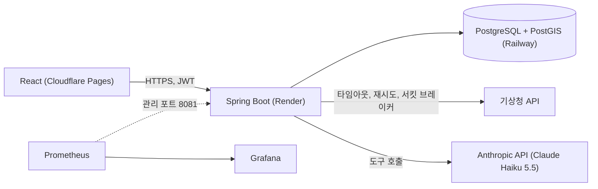
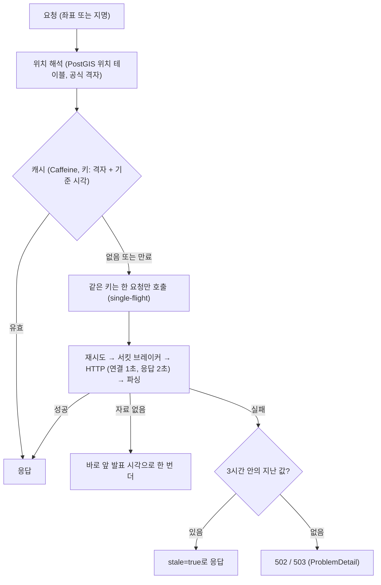
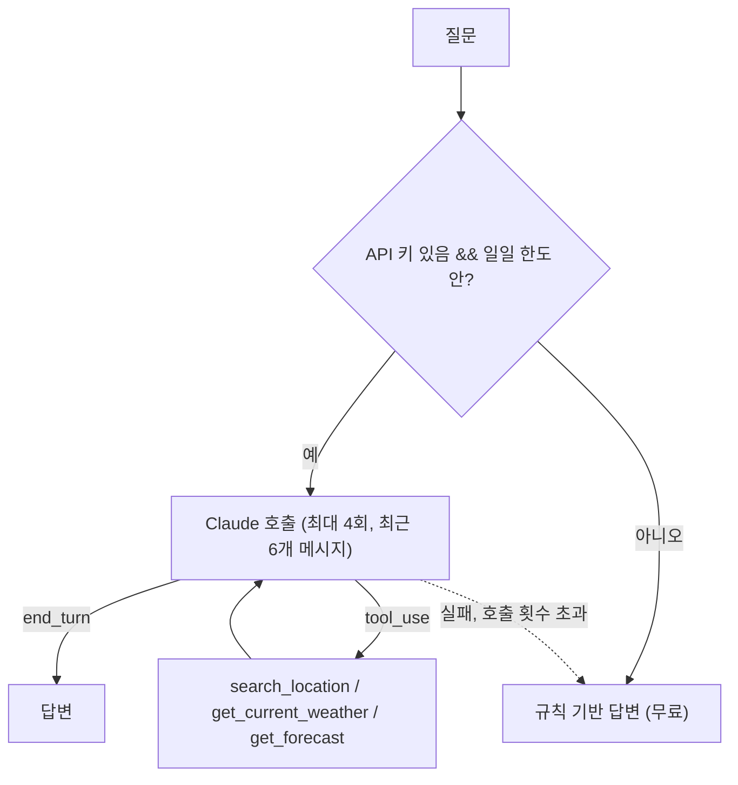
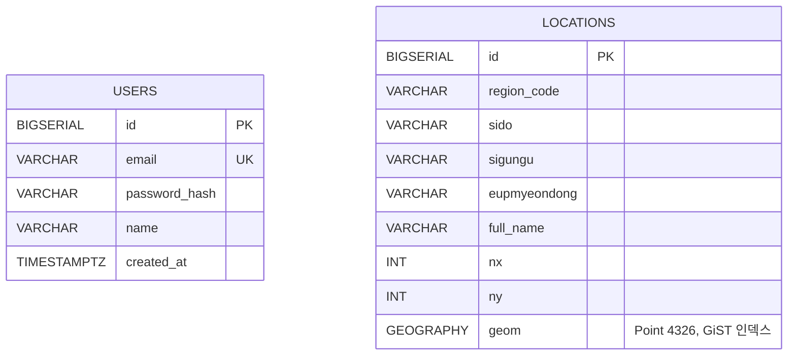

# Weather WEP (오늘 날씨 어때?)

[](https://github.com/dlalstlr12/weather-wep/actions/workflows/ci.yml)

기상청 데이터로 현재 날씨와 예보를 보여 주고, 지도에서 장소를 찾고, 날씨를 물어볼 수 있는 챗(LLM)을 제공하는 풀스택 프로젝트입니다. React + Spring Boot, PostgreSQL/PostGIS로 만들었고 Cloudflare Pages, Render, Railway에 배포했습니다.

이 저장소의 중심은 **외부 API에 기대는 서비스를 어떻게 안정적으로 만들고, 어떻게 측정으로 확인했는가**입니다. 개선마다 "전 → 후"를 같은 조건에서 재고, 측정 환경과 한계를 문서에 적었습니다.

- 프론트엔드: https://weather-wep.pages.dev
- 백엔드 API: https://weather-wep.onrender.com (무료 티어라 한동안 요청이 없으면 첫 응답이 느립니다)
- 프로젝트 노션: https://aback-may-a76.notion.site/

> **처음 접속할 때 주의**: 백엔드는 무료 호스팅(Render)이라 한동안 접속이 없으면 서버가 잠들고, 첫 접속 때는 다시 켜지는 데 시간이 걸립니다. 그 사이에는 로그인과 챗이 실패할 수 있어서 **화면 위쪽에 서버 상태 안내**가 뜹니다 ("서버를 깨우는 중이에요" → "서버가 준비됐어요"). 안내가 "준비됐어요"로 바뀐 뒤에 시도해 주세요. 서버 오류가 아니라 깨어나는 중입니다.

## 이 프로젝트에서 다룬 것
아래 수치는 모두 **로컬 PC 한 대에서 잰 값**이고, 기상청은 WireMock 대역, 평가의 날씨는 가짜 데이터입니다. 운영 환경에서 잰 값이 아닙니다. 조건과 한계는 각 문서에 있습니다.

| 영역 | 전 | 후 | 근거 |
|---|---|---|---|
| 외부 API 장애 대응 | 기상청 장애가 403 빈 본문으로 나감. 응답이 5초 늦으면 요청 스레드 50개가 모두 대기해 날씨와 무관한 요청도 중앙값 4.5초. 장애 중에도 요청마다 기상청 호출 | 타임아웃, 재시도, 서킷 브레이커, 캐시(같은 키 동시 요청 합치기, 실패 시 지난 값 응답). 무관한 요청 중앙값 2ms, 500 장애 시 기상청 호출 20회(요청 701~1,987건), 같은 키 동시 50요청이 기상청 호출 1회로 | [기준선](docs/baseline.md), [Phase 2](docs/phase2-resilience.md) |
| 위치 검색 | 도시 11곳 하드코딩 | PostGIS, 기상청 행정구역 3,836곳과 공식 격자. 공간 인덱스로 반경 5km 검색 5.31ms → 0.245ms(서울), 6.06ms → 0.046ms(인제) | [Phase 3](docs/phase3-postgis.md) |
| 챗 | 키워드로 의도를 읽고 로컬 소형 모델에 프롬프트, 완성된 답을 잘라 보내는 가짜 스트리밍 | Claude Haiku 5.5 도구 호출(위치 검색·현재·예보), 멀티턴, 호출 횟수·토큰·일일 사용량 상한, LLM을 못 쓰면 규칙 기반 답변으로 대체. 질문당 약 $0.0003. 진짜 SSE 스트리밍(도구 조회 상태 표시 + 답변 조각) | [Phase 4](docs/phase4-llm-chat.md), [Phase 7](docs/phase7-chat-streaming.md) |
| 챗 평가 | 없음 | 50문항 평가셋(훈련 35 / 시험 15)과 코드 채점기. 처음 보는 15문항 평균 84.4%(3회), 개선 후 전체 50문항 평균 98.7%(시험셋은 개선 뒤 미공개가 아님). 평가가 모델이 날짜를 지어내는 문제를 찾아냄 | [Phase 5](docs/phase5-eval.md) |
| 관측 | 없음 | Micrometer 측정값 11종, Prometheus + Grafana 대시보드 16패널. 장애 주입 시나리오로 측정값이 실제 동작과 일치함을 확인 | [Phase 6](docs/phase6-observability.md) |
| 테스트·CI | 테스트 0개 | 테스트 192개, JaCoCo 줄 커버리지 91.0%(분기 73.1%, 하한선 87%), GitHub Actions | [Phase 6](docs/phase6-observability.md), [Phase 7](docs/phase7-chat-streaming.md) |

작업 중 겪은 문제와 해결은 [docs/troubleshooting.md](docs/troubleshooting.md)에 모았습니다. 전체 문서 목록은 [docs/README.md](docs/README.md)입니다.

## 아키텍처


### 기상청 조회 경로


### 챗 경로


## 주요 설계 결정
- **LLM에는 판단만 맡기고 숫자는 서버 데이터에서만 가져온다.** 모델은 도구 호출만 결정하고, 답변의 날씨 값은 도구 결과여야 하며, 평가가 이를 코드로 검사합니다(근거 없는 숫자와 날짜).
- **LLM은 언제든 꺼질 수 있다고 가정한다.** 키 없음, 한도 초과, 호출 실패, 호출 횟수 초과 모두 규칙 기반 답변으로 대체됩니다. 재시도는 비용이라 LLM 호출에는 두지 않았습니다.
- **측정값은 서비스 포트가 아니라 관리 포트(8081)에서만 연다.** Render는 서비스 포트 하나만 공개해 밖에서 보이지 않습니다.
- **모든 개선은 전후를 같은 조건에서 재고, 측정 방법의 실수도 기록한다.** 예: 인덱스 벤치마크에 세션 초기화 비용이 섞여 값을 폐기하고 다시 쟀고, 평가 코드의 설정 오류와 채점 기준을 고친 이력을 문서에 남겼습니다.

## 핵심 기능
- 현재 위치, 지도 클릭, 도시·지역 검색, 장소 검색(입력하면 검색창 아래에 결과 목록)으로 현재 날씨와 3시간 간격 예보 조회
- 기상청 장애 시 지난 값을 "N분 전 데이터"로 안내
- 서버가 잠들어 있거나 DB에 연결되지 않았을 때 화면 위에 상태 안내(깨우는 중, 경과 시간, 준비되면 자동 전환)와 연결 문제를 구분한 오류 문구
- 즐겨찾기 도시와 지도 마커
- 회원가입, 로그인(JWT), 로그인한 사용자만 쓰는 날씨 챗
- 챗: 지명 검색, 현재 날씨, 예보를 도구로 조회하며 멀티턴 대화. 도구를 조회하는 동안 상태를 보여 주고 답변을 조각으로 받아 그린다

## 모노레포 구조
```
root
├─ frontend/              # React(Vite, TypeScript)
├─ backend/               # Spring Boot (Java 17), Flyway 마이그레이션 V1~V4
├─ docs/                  # 단계별 설계·측정·평가 문서
├─ eval/results/          # 챗 평가 원본 결과(JSON)
├─ perf/                  # 장애 주입·PostGIS 벤치마크 스크립트와 결과
├─ observability/         # Prometheus 설정, Grafana 데이터소스·대시보드
├─ tools/                 # 행정구역 격자 마이그레이션 생성 스크립트
├─ docker-compose.yml     # 로컬 통합 실행 (--profile observability로 Prometheus/Grafana 추가)
├─ .github/workflows/     # GitHub Actions CI
└─ Jenkinsfile            # (선택) Jenkins 파이프라인
```

---

# 실행 방법
## 1) 로컬 (Docker Compose)
```bash
cp .env.example .env     # POSTGRES_PASSWORD, JWT_SECRET(32자 이상) 등을 채운다
docker compose up --build
# 프론트 http://localhost:5173, 백엔드 http://localhost:8080
```
- 프론트는 `frontend/.env`에 `VITE_API_BASE_URL=http://localhost:8080`(백엔드 주소)과 `VITE_KAKAO_MAPS_KEY`(Kakao 지도 키)를 두면 Vite가 빌드와 개발 서버(`npm run dev`) 시작 때 읽습니다.
- `KMA_SERVICE_KEY`가 없으면 날씨 조회가 실패합니다. `ANTHROPIC_API_KEY`가 없으면 챗이 규칙 기반 답변만 합니다.
- 관측 스택: `docker compose --profile observability up -d --build db backend prometheus grafana` → Grafana http://localhost:3000, Prometheus http://localhost:9090

## 2) 테스트
```bash
cd backend && mvn verify                  # 테스트 192개 + 커버리지 하한선 검사 (Docker 필요: Testcontainers)
cd frontend && npm ci && npm run build    # 타입 검사 + 빌드
```
- 챗 평가(실제 Anthropic API를 호출해 과금됨, 기본 테스트에서 제외): `cd backend && mvn test -Dtest=ChatEvalTest -Dtest.excludedGroups=none` (방법은 [docs/phase5-eval.md](docs/phase5-eval.md))
- 장애 주입·성능 측정: [perf/README.md](perf/README.md)

## 3) 배포 환경
- 프론트: Cloudflare Pages (환경변수 `VITE_API_BASE_URL`, `VITE_KAKAO_MAPS_KEY` 설정 후 빌드)
- 백엔드: Render (Dockerfile 빌드, Flyway 마이그레이션 자동 실행)
- DB: Railway PostGIS 템플릿(PostgreSQL 16, PostGIS 3.4). `SPRING_DATASOURCE_URL`은 `jdbc:postgresql://HOST:PORT/DB` 형식이어야 하고 사용자·비밀번호는 `SPRING_DATASOURCE_USERNAME`, `SPRING_DATASOURCE_PASSWORD`로 따로 넣습니다. `postgis` 확장은 Flyway V3가 만듭니다

# 환경 변수
## 프론트엔드
- `VITE_API_BASE_URL`: 백엔드 API 주소 (끝에 슬래시 없이)
- `VITE_KAKAO_MAPS_KEY`: Kakao 지도 JavaScript 키 (Kakao Developers에 배포 도메인 등록 필요)

## 백엔드
| 이름 | 필수 | 설명 |
|---|---|---|
| `SPRING_DATASOURCE_URL`, `SPRING_DATASOURCE_USERNAME`, `SPRING_DATASOURCE_PASSWORD` | 예 | PostgreSQL 접속 정보 |
| `JWT_SECRET` | 예 | 32자 이상. 코드에 기본값이 없어 없으면 기동하지 않습니다 |
| `KMA_SERVICE_KEY` | 날씨 조회에 필요 | 기상청 서비스 키 |
| `ANTHROPIC_API_KEY` | 아니오 | 챗 LLM. 없으면 규칙 기반 답변 |
| `MANAGEMENT_PORT` | 아니오 | 측정값·health 관리 포트 (기본 8081) |
| `PORT` | 아니오 | 서비스 포트 (호스팅 제공자가 주입) |

호출 상한, 타임아웃, 캐시 같은 튜닝 값은 `backend/src/main/resources/application.yml`의 `kma.*`, `anthropic.*`에 있습니다.

---

# 보안
- Spring Security + JWT. 공개: `/`, `OPTIONS /**`, `GET /api/weather/**`, `GET /api/locations/**`, `GET /api/health`, `/api/auth/**`. 그 외 모든 API(특히 `/api/chat/**`)는 로그인이 필요합니다 (통합 테스트로 확인).
- 시크릿(DB 비밀번호, JWT, API 키)은 코드에 기본값이 없고 환경변수로만 받습니다. `.env`는 저장소에 올리지 않습니다.
- 오류 메시지와 로그에는 기상청 서비스 키가 든 URL을 남기지 않습니다.
- 챗은 사용자별·전체 일일 사용 횟수, 입력 길이, 응답 토큰에 상한이 있습니다 (비용 보호).
- 측정값은 별도 관리 포트에서만 열립니다.
- CORS 허용 오리진: `https://weather-wep.pages.dev`, `http://localhost:5173`

# 데이터 모델

- `locations`는 기상청 행정구역 3,836행(마이그레이션 V4). 이름 검색은 `pg_trgm` GIN 인덱스, 반경·최근접 검색은 GiST 인덱스(`ST_DWithin`, KNN `<->`)를 씁니다. 날씨 캐시는 DB가 아니라 서버 메모리(Caffeine)입니다.
- 실제 스키마는 `backend/src/main/resources/db/migration` 기준입니다.

# API 요약
Base URL: `https://weather-wep.onrender.com` (로컬 `http://localhost:8080`). 오류 응답은 `ProblemDetail`(RFC 9457)이고 입력 오류 400, 기상청 응답 오류 502(`kind` 포함), 기상청 일시 불가 503입니다.

| 메서드 | 경로 | 인증 | 설명 |
|---|---|---|---|
| POST | `/api/auth/signup` | 없음 | `{ name, email, password }` → 200 (본문 없음) |
| POST | `/api/auth/login` | 없음 | `{ email, password }` → `{ accessToken }` |
| GET | `/api/weather/current` | 없음 | `?lat=&lon=` 또는 `?city=` (`nocache=true`로 캐시 우회) → `{ temperature, precipitation, sky, stale, ageSeconds }` |
| GET | `/api/weather/forecast` | 없음 | 같은 파라미터 → `{ items: [...], stale, ageSeconds }` |
| GET | `/api/locations/search` | 없음 | `?q=역삼&limit=10` 이름 일부로 지역 검색 |
| GET | `/api/health` | 없음 | 서버 상태 확인(DB 연결까지, 3초 제한). 200 `{ status: "UP" }` / 503 `{ status: "DOWN", reason: "database" }`. 프론트의 서버 상태 안내가 사용 |
| GET | `/api/locations/nearby` | 없음 | `?lat=&lon=&radiusKm=10&limit=10` 반경 안 지역을 가까운 순으로 |
| POST | `/api/chat` | JWT | `{ messages: [{ role, content }], lat?, lon?, city? }` → `{ content }` |
| POST | `/api/chat/stream` | JWT | 같은 요청을 SSE로. 이벤트 `status`(도구 조회 중), `delta`(답변 조각), `reset`, `done`, `error` (데이터는 JSON) |

---

# CI/CD
- **CI**: GitHub Actions(`.github/workflows/ci.yml`)가 push(main)와 PR마다 백엔드 `mvn verify`(테스트 + JaCoCo 줄 커버리지 하한선 87%)와 프론트 `npm run build`(타입 검사 포함)를 실행합니다.
- **배포**: 프론트는 Cloudflare Pages, 백엔드는 Render가 Git 연동으로 자동 배포합니다. DB 마이그레이션은 백엔드 기동 시 Flyway가 수행합니다.
- 선택: Jenkinsfile(테스트, 빌드, 이미지 푸시)이 있습니다.

# 한계
- 모든 성능·평가 수치는 로컬 한 대에서 기상청 대역으로 잰 값이고, 운영 환경(Render 무료 티어, 실제 기상청)의 값이 아닙니다. 실제 기상청은 배포 후 확인에서 캐시 없는 호출이 캐시된 호출보다 약 1.2~1.3초 더 걸렸고(각 8회 관측, 한 번의 확인), 읽기 타임아웃(2초)과 가깝습니다.
- 운영에는 Prometheus가 없어 운영 측정값은 볼 수 없고, 알림도 없습니다.
- Render 무료 티어 관측(배포 로그와 사용자 확인, 각 1~2회): 앱 기동이 154초(`Started WeatherApplication in 154.099 seconds`, 로컬은 약 8.5초), 첫 백엔드 배포가 약 10분(원인 미확정), 같은 커밋을 다시 배포하면 약 3분. 서버가 잠든 뒤 깨어나는 데도 기동 시간이 최소로 듭니다 (화면의 서버 상태 안내가 이를 알려 줍니다).
- 스트리밍은 답변이 1~2문장이라 글자 흐름의 이득은 작고(첫 글자 이후 전체까지 0.3~0.5초), 체감 개선은 주로 "조회 중" 상태 표시입니다. 운영(Render, Cloudflare)에서 조각으로 도착하는지는 확인하지 못했습니다.
- 챗 평가는 50문항(시험 15문항)이라 표본이 작고, 모호한 지명("서구" 등)에서 되묻지 않는 경우가 남아 있습니다.
- 서킷 브레이커와 캐시는 서버 메모리라 인스턴스가 늘면 인스턴스마다 따로입니다. 챗의 일일 사용 한도도 메모리에만 있어 재시작하면 초기화됩니다.
- 위치 검색은 부분 일치라 동명 지역(예: 중구 5곳)을 구분하지 못합니다.

---

# 라이선스
본 저장소는 포트폴리오 목적의 예시 프로젝트로, 별도의 라이선스 명시가 없는 한 개인 학습 및 시연 용도로 사용 가능합니다.

# 데이터 출처
- 행정구역별 기상청 격자 좌표: 기상청 단기예보 조회서비스 오픈API 활용가이드의 '격자 위경도' (공공데이터포털, [공공누리 제1유형](https://www.data.go.kr/data/15084084/openapi.do) 출처표시). 적재 방법과 데이터 설명은 [docs/phase3-postgis.md](docs/phase3-postgis.md) 참고
