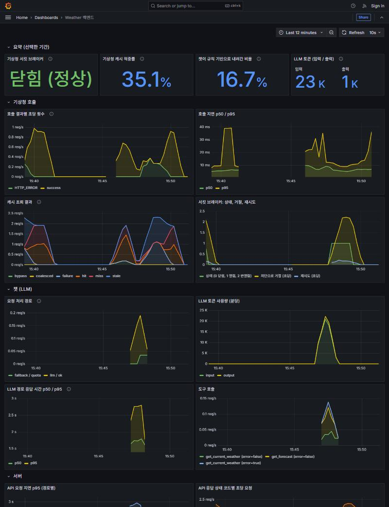
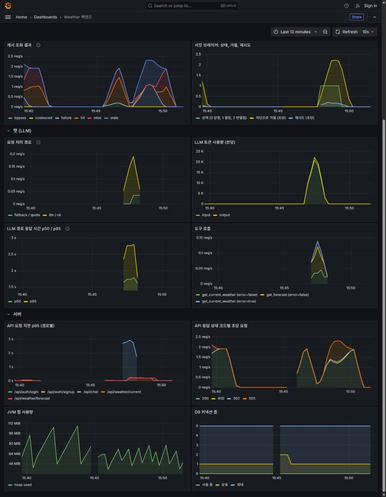

# Phase 6 관측성·CI·테스트 정리 (2026-10-18)

서버가 어떻게 돌고 있는지 숫자로 볼 수 있게 하고(Micrometer → Prometheus → Grafana), 푸시할 때마다 테스트와 커버리지를 자동으로 확인하게(GitHub Actions + JaCoCo) 했다.

## 1. 측정값
`spring-boot-starter-actuator`와 `micrometer-registry-prometheus`를 추가하고, 직접 만든 측정값을 넣었다. 모든 측정값에 `application="weather-backend"` 태그가 붙는다.

| 이름 (Prometheus 표기) | 종류 | 태그 | 의미 |
|---|---|---|---|
| `kma_upstream_attempt_seconds` | 타이머(히스토그램) | endpoint, outcome | 기상청 HTTP 시도 한 번의 소요 시간. outcome은 success 또는 실패 종류(HTTP_ERROR, UNREACHABLE, RESULT_CODE, PARSE_ERROR, NO_DATA). 재시도는 시도마다 따로 센다 |
| `kma_retry_attempts_total` | 카운터 | - | 재시도 횟수 |
| `kma_circuit_state` | 게이지 | - | 서킷 브레이커 상태 (0 닫힘, 1 열림, 2 반열림) |
| `kma_circuit_transitions_total` | 카운터 | to | 상태 전이 횟수 (CLOSED, OPEN, HALF_OPEN) |
| `kma_circuit_rejected_total` | 카운터 | - | 브레이커가 열려 호출하지 않고 거절한 횟수 |
| `kma_cache_requests_total` | 카운터 | result | hit(유효한 캐시) / miss(새로 불러옴) / coalesced(진행 중인 호출을 기다림) / stale(실패해서 지난 값으로 대체) / failure(실패, 대체할 값 없음) / bypass(nocache) |
| `kma_cache_size` | 게이지 | - | 캐시에 들어 있는 항목 수 |
| `chat_requests_total` | 카운터 | path, reason | path=llm이면 reason=ok. path=fallback이면 reason은 disabled(키 없음) / quota(한도 초과) / error(호출 실패) / call_limit(호출 횟수 초과) / empty(빈 응답) |
| `chat_llm_tokens_total` | 카운터 | type | LLM 입력·출력 토큰 |
| `chat_llm_duration_seconds` | 타이머(히스토그램) | outcome | LLM 경로 한 질문의 전체 시간(도구 호출 왕복 포함) |
| `chat_tool_calls_total` | 카운터 | tool, error | 도구 호출 횟수. 모델이 지어낸 이름은 `unknown` 하나로 묶어 태그가 무한히 늘지 않게 했다 |

이 밖에 Actuator 기본값(JVM, HikariCP, `http_server_requests`)도 같이 나온다. `http.server.requests`는 지연 분위수를 계산할 수 있게 히스토그램을 켰다.

**카운터는 시작할 때 0으로 등록한다.** Prometheus의 `increase()`는 처음 생긴 시계열의 첫 증가를 세지 못한다. 처음 대시보드에서 "챗이 규칙 기반으로 내려간 비율"이 0.0%로 나왔는데 실제는 12건 중 2건(16.7%)이었고, 원인이 이것이었다. 가능한 태그 조합을 0으로 미리 등록한 뒤 같은 시나리오를 다시 돌려 16.7%로 맞는 것을 확인했다. 타이머는 outcome 조합이 많아 미리 등록하지 않았고, 비율 패널에는 쓰지 않는다.

### 노출 방식
- 측정값(`/actuator/prometheus`)과 `/actuator/health`는 서비스 포트(8080)가 아니라 **별도 관리 포트(기본 8081, `MANAGEMENT_PORT`)** 에서만 열린다. 배포 환경(Render)은 서비스 포트 하나만 공개하므로 밖에서는 접근할 수 없다.
- 이전에는 보안 설정에 `/actuator/**`가 공개로 적혀 있었지만 액추에이터 의존성이 없어 실제로는 아무것도 열려 있지 않았다. 이번에 의존성을 추가하면서 측정값이 서비스 포트로 공개되지 않도록 포트를 분리했다.
- 통합 테스트(`ActuatorEndpointsTest`)가 실제 서버를 띄워 확인한다: 관리 포트에서는 health UP과 측정값이 나오고, 서비스 포트에서는 `/actuator/prometheus`와 `/actuator/health`가 404다.

## 2. Prometheus + Grafana
- `docker compose --profile observability up -d --build db backend prometheus grafana` (프로필을 켜지 않으면 기존 스택 그대로)
- Prometheus(`127.0.0.1:9090`)가 compose 네트워크 안에서 `backend:8081`을 15초마다 수집한다. 관리 포트는 호스트에 매핑하지 않았다.
- Grafana(`127.0.0.1:3000`)에는 데이터소스와 대시보드(`observability/grafana/dashboards/weather-backend.json`, 16개 패널)가 파일로 자동 등록된다. 두 포트 모두 로컬에서만 접근된다.
- 대시보드 구성: 요약(서킷 상태, 캐시 적중률, 규칙 기반 비율, 토큰), 기상청 호출(결과별 횟수, 지연 p50/p95, 캐시 결과, 서킷·재시도), 챗(처리 경로, 토큰, 응답 시간, 도구 호출), 서버(API 지연, 상태 코드, JVM 힙, DB 커넥션 풀)




## 3. 시나리오로 확인한 결과
**환경**: 로컬 PC의 Docker(compose), 기상청은 호스트의 WireMock 대역(정상 응답과 HTTP 500 응답을 전환), 캐시 TTL 20초, 서킷 브레이커는 기본 설정, Anthropic은 실제 API. 단일 인스턴스. 부하 테스트가 아니라 측정값이 실제 동작을 반영하는지 보는 용도다.

**절차** (약 4분 40초): 정상 트래픽 70초 → 챗 12건 → 기상청에 500 주입 90초 → 복구 60초

| 구간 | 요청 결과 (클라이언트 기록) |
|---|---|
| 정상 | 200 × 134 |
| 장애 주입 | 200 × 119, 502 × 8, 503 × 79 |
| 복구 | 200 × 110, 503 × 6 |

**Prometheus 값과 클라이언트 기록이 일치하는지**: `http_server_requests`의 /api 응답은 200이 376건, 502가 8건, 503이 85건, 400이 1건이다. 클라이언트 기록으로 계산한 값과 같다(200 = 134 + 119 + 110 + 챗 12 + 로그인 1, 503 = 79 + 6, 400은 이미 있는 계정으로 다시 가입을 시도한 것).

측정값에서 읽은 동작 (이 시나리오, 이 환경):
- **서킷 브레이커**: 장애 구간에 OPEN 9회, HALF_OPEN 9회, 열려 있어서 거절한 호출 208건, 복구 후 CLOSED로 돌아와 상태는 닫힘. 실제 기상청 HTTP 시도는 성공 115건 / HTTP_ERROR 33건(재시도 20건 포함)이라, 브레이커가 열린 동안 대부분의 호출이 기상청까지 가지 않았다.
- **캐시**: hit 130, miss 102, stale 128, failure 93, bypass 13. 장애 중에도 이미 받아 둔 도시는 stale(지난 값)로 200 응답을 했고, 처음 보는 도시는 failure로 5xx가 됐다.
- **챗**: 12건 중 LLM 10건(ok), 하루 한도 초과로 규칙 기반 2건(quota). 토큰 입력 22,379 / 출력 1,375, 질문당 평균 약 2.2k / 0.14k. 도구 호출 9건(성공 8건, 오류 1건. 오류는 위치 없는 질문에서 도구가 오류를 돌려주고 되묻는 정상 경로). LLM 경로 평균 약 1.96초.
- 비용: 위 토큰에 입력 $0.10 / 출력 $0.50 per MTok을 곱하면 10건에 약 $0.003 (계산값).

## 4. 테스트와 커버리지 (JaCoCo)
- JaCoCo 줄 커버리지를 `mvn verify`에서 측정하고 **하한선 87%** 를 두었다(`jacoco.line.minimum`, 측정값보다 약 3%포인트 낮게). 아래로 떨어지면 빌드가 실패한다. 리포트는 `backend/target/site/jacoco/`.
- 측정 이력(줄): 처음 85.4%(테스트 157개) → 보안·컨트롤러 통합 테스트 추가 후 89.9% → 최종 **90.0% (924/1027줄), 분기 71.7% (434/605)**, 테스트 175개.
- 처음 측정에서 비어 있던 곳이 컨트롤러(30%)와 보안(28%)이었다. "챗은 로그인해야 쓸 수 있다"를 지키는 부분이라 `ApiSecurityIntegrationTest`(6개)를 추가했다: 토큰 없이 챗 호출은 403, 잘못된 토큰은 403, 로그인 후 챗은 응답(LLM 없이 규칙 기반), 날씨는 공개, 중복 가입과 틀린 비밀번호는 400.
- 새 테스트: `KmaMetricsTest`(6), `ChatMetricsTest`(4), `ActuatorEndpointsTest`(2), `ApiSecurityIntegrationTest`(6). 측정값 테스트는 호출 결과·캐시·서킷 상태가 실제 동작과 같은 값으로 기록되는지 확인한다.
- 패키지별 줄 커버리지(최종 직전 측정): service 94%, chat 97%, location 100%, config 100%, security 79%, controller 42%, 앱 시작 클래스 4%.

## 5. CI
- **GitHub Actions** (`.github/workflows/ci.yml`): push(main)와 PR마다 ① 백엔드 `mvn -B verify`(Testcontainers가 쓰는 Docker는 GitHub 러너에 있다, 테스트 + 커버리지 하한선 검사, 커버리지 리포트 업로드) ② 프론트 `npm ci && npm run build`(타입 검사 포함). README에 배지를 붙였다.
- **Jenkinsfile**: 백엔드 단계를 `mvn test`에서 `mvn verify`로 바꿔 커버리지 하한선도 검사하게 했다.
- 로컬에서 같은 명령(`mvn -B verify`, `npm run build`)이 통과하는 것을 확인했고 워크플로 YAML 문법도 검사했다.

## 한계
- **GitHub Actions는 아직 GitHub에서 실행해 보지 않았다.** 워크플로 파일은 푸시한 뒤 첫 실행에서 확인된다.
- 운영(Render)에는 Prometheus와 Grafana가 없다. 관리 포트는 열려 있지만 수집기가 없어서 운영 측정값은 지금 볼 수 없다(무료 티어에서 Prometheus를 상시 돌리지 않았다).
- 알림(Alertmanager)과 장기 보존은 없다. 대시보드는 로컬 확인용이다.
- 위 시나리오는 단일 인스턴스, 로컬, 기상청 대역으로 잰 값이다. 운영 환경의 지연·적중률이 아니다.
- 커버리지 하한선은 줄 기준만 있다. 분기 71.7%, 컨트롤러 42%(스트리밍 경로 등), JaCoCo는 줄이 실행됐는지만 알려 주고 검증이 충분한지는 알려 주지 않는다.
- Grafana 요약 패널의 비율은 `increase()`로 계산해서 근사값이다(패널 설명에 적었다).

## 재현
```bash
# 단위·통합 테스트와 커버리지 (Docker 필요)
cd backend && mvn verify
# 관측 스택 (POSTGRES_PASSWORD, JWT_SECRET 등 필요)
docker compose --profile observability up -d --build db backend prometheus grafana
# Grafana http://localhost:3000, Prometheus http://localhost:9090
```
